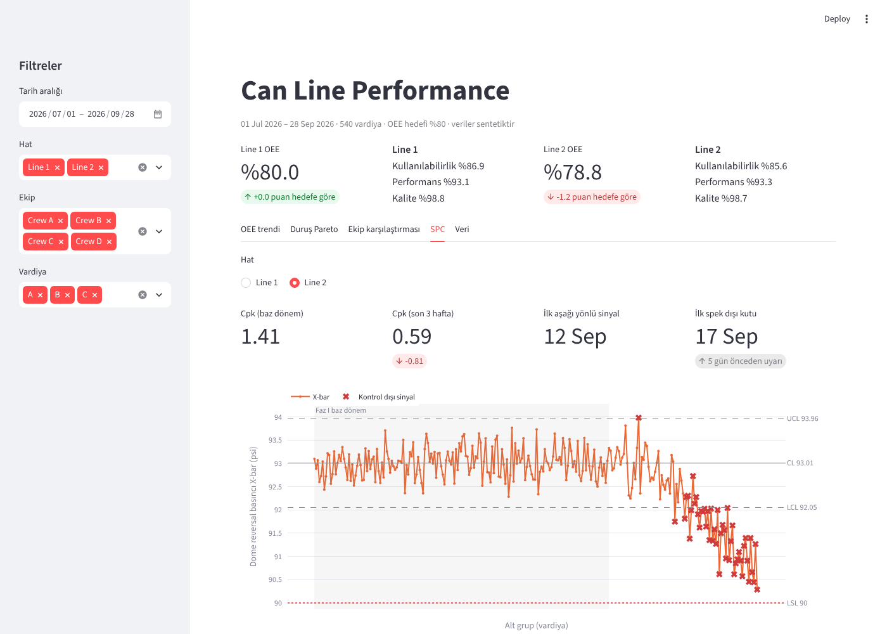

# Can Line Performance Analytics

[](https://github.com/enesuykun/can-line-performance-analytics/actions/workflows/ci.yml)

Alüminyum içecek kutusu üreten bir fabrika için uçtan uca operasyon analitiği: **OEE**, **duruş Pareto analizi**, **ekip karşılaştırması**, **Western Electric kurallarıyla SPC (X-bar/R)**, **proses yeterliliği (Cpk)** ve Excel'de otomatik hazırlanan **günlük operasyon toplantısı raporu**.

> Tüm veriler sentetiktir ve `src/generate_data.py` ile üretilir. Analizin her problemi nasıl tespit ettiğini gösterebilmek için veriye bilinçli olarak problemler yerleştirilmiştir.

## İş sorusu

Fabrikada iki kutu hattı, üç vardiya ve dönüşümlü çalışan dört ekip var. Operasyon ekibi her sabah toplanıyor ve şu sorulara cevap arıyor:

1. OEE hedefini tutturuyor muyuz, zamanı nerede kaybediyoruz?
2. Kayıp makineden mi, yoksa makinenin nasıl çalıştırıldığından mı kaynaklanıyor?
3. Kritik bir kalite karakteristiği spek dışına çıkmadan **önce** kayıyor mu?
4. Bugün aksiyon listesine (PDCA) neler girmeli?

## Sonuçlar

| Bulgu | Kanıt | Önerilen aksiyon |
|---|---|---|
| Hat 2 OEE'si **%78,8**, %80 hedefinin 1,2 puan altında | OEE = Kullanılabilirlik x Performans x Kalite, vardiya verisinden toplanarak hesaplandı | Kullanılabilirlik kayıplarına odaklanılmalı |
| Hat 2'deki dekoratör duruşları **ekibe özgü**: Crew C'de vardiya başına ~52 dk, diğer ekiplerde ~9 dk | Mann-Whitney U testi, p < 0,001; Crew C OEE %72,9, diğer ekipler %79,7-82,3 | Crew C ile gemba, mürekkep/blanket değişim SOP'si ve eğitim kayıtlarının gözden geçirilmesi |
| Hat 1'de dönemin ikinci yarısında changeover sayısı iki katına çıktı, süreleri **~%70 uzadı** (~38 saat ek kayıp) | Önce/sonra karşılaştırması, p = 0,001 | SMED çalışması |
| Hat 2'de dome reversal basıncı aşağı kayıyor; SPC, ilk kutu spek altına düşmeden **5 gün önce** uyarı verdi. Cpk 1,41'den 0,59'a düştü | X-bar/R kartı, kontrol limitleri 60 günlük baz dönemden, Kural 1 + 8 noktalı seri kuralı | Bodymaker dome kalıbında aşınma kontrolü |

Otomatik üretilen detaylı bulgular: [`outputs/insights.md`](outputs/insights.md)

### Haftalık OEE


### Duruş Pareto analizi


### Ekip bazında OEE


### SPC - Hat 2 dome reversal basıncı


## İnteraktif dashboard

`streamlit run app.py` ile açılan dashboard'da tarih, hat, ekip ve vardiya filtreleriyle şunlar incelenebilir:

- Hat bazında OEE ve kırılımları (kullanılabilirlik / performans / kalite), hedefe göre fark
- Haftalık veya günlük OEE trendi
- Duruş Pareto analizi; kaybın ~%80'ini oluşturan nedenler vurgulanır
- Hat x ekip OEE ısı haritası ve dekoratör duruşları için Mann-Whitney U testi
- X-bar/R kontrol kartı, Cpk ve SPC'nin kaç gün önceden uyarı verdiği
- Filtrelenmiş vardiya verisinin CSV olarak indirilmesi



## ERP / MES entegrasyonu (SAP, Netsis)

Analiz kodu kaynaktan bağımsızdır; yalnızca üç tablodan oluşan **ortak şemayı** bilir (`production_shifts`, `downtime_events`, `quality_samples`). ERP ve MES'ten gelen veri bir YAML config ile bu şemaya çevrilir, doğrulanır ve sonra analize girer:

```
SAP (OData) / Netsis (SQL) / MES (SQL) / LIMS (Excel)
        │  src/sources.py   config/*.yaml: bağlantı, sorgu, alan ve kod eşleme, birim çevirme, vardiyaya toplama
        ▼
  ortak şema ──► src/validate.py  (mükerrer teyit, negatif süre, eksik vardiya, ERP-MES tutarsızlığı ...)
        │
        ▼
  analysis.py · dashboard · günlük Excel raporu
```

| Ortak alan | Tipik kaynak | Not |
|---|---|---|
| Vardiya üretimi (süre, adet, fire) | ERP üretim teyitleri: SAP PP, Netsis Üretim | Teyitler iş emri bazındadır, vardiyaya toplanır |
| İdeal hız | ERP ana verisi (iş yeri / rota standart değeri) | |
| Duruş olayları | MES / SCADA, bazen operatör Excel'i | ERP'de genelde dakika bazında duruş tutulmaz |
| Kalite ölçümleri | SAP QM veya laboratuvar sistemi (LIMS) | |

**Demo (Netsis tarzı örnek veritabanı):**

```bash
python src/build_demo_erp.py                     # iş emri bazında, bin adet, saniye, kodlu örnek ERP + MES
python src/ingest.py --config config/netsis_demo.yaml --out data/erp
python src/analysis.py --data data/erp

python src/build_demo_erp.py --dirty             # tipik ERP hatalarını ekle
python src/ingest.py --config config/netsis_demo.yaml --out data/erp   # doğrulama raporu, hata varsa veri yazılmaz
```

Örnek veritabanındaki tablo ve alan adları **kurgusaldır**; gerçek bir Netsis kurulumunun tablolarını temsil etmez. Gerçek kurulumda IT'nin açtığı salt okunur view'lar kullanılır ve sadece config değişir.

**Config'ler:**
- [`config/netsis_demo.yaml`](config/netsis_demo.yaml): SQL ile okuma; vardiyaya toplama veritabanında (`GROUP BY`), kod eşleme ve birim çevirme config'te. MS SQL Server bağlantı örneği dosyada.
- [`config/sap_s4_example.yaml`](config/sap_s4_example.yaml): SAP S/4HANA üretim teyitleri OData'dan (sayfalı okuma, `/Date()/` çevrimi), duruşlar MES'ten, kalite LIMS Excel'inden. Servis ve alan adları örnektir; sistemdeki `$metadata` ile doğrulanmalıdır. Testlerde sahte bir OData cevabıyla sınanır.

**Kurumsal ortamda dikkat edilecekler:** salt okunur teknik kullanıcı; şifreler config'te değil ortam değişkeninde (`${SAP_PASSWORD}`); SAP veritabanına doğrudan bağlanmak yerine OData veya veri ambarı (lisans ve güvenlik); eşlemesi olmayan bir kod (ör. yeni bir hat) sessizce atlanmaz, hata verir; operatör bazında analiz KVKK kapsamındadır.

## Günlük operasyon toplantısı raporu

`outputs/daily_ops_report.xlsx` her çalıştırmada yeniden oluşturulur ve şunları içerir:

| Sayfa | İçerik |
|---|---|
| Daily KPI | Hat/vardiya/ekip bazında kullanılabilirlik, performans, kalite ve OEE'nin hedefe göre durumu, kırmızı/yeşil renklendirme |
| Top Losses | Bir önceki günün duruşları; neden, süre ve tahmini kayıp kutu adedi |
| SPC Status | Kontrol limitleri, son alt grup, Cpk ve son 3 vardiyada sinyal olup olmadığı |
| Action Log (PDCA) | Sorumlu, termin ve bir sonraki adımla açık aksiyonlar |

## Yöntemler

- **OEE**, toplama hatası (aggregation bias) olmaması için oranların ortalaması alınarak değil, toplam miktarlar üzerinden hesaplandı.
- Duruş nedenlerini önceliklendirmek için **Pareto analizi** (80/20).
- Duruş süreleri çarpık dağıldığı ve çok sayıda sıfır içerdiği için **parametrik olmayan hipotez testi** (Mann-Whitney U).
- **SPC**: X-bar/R kartı (n = 5); Faz I limitleri baz dönemden, Faz II izlemesi Kural 1 (limit dışı nokta) ve art arda 8 nokta kuralıyla.
- **Proses yeterliliği**: alt spek limitine göre tek taraflı Cpk.

## Proje yapısı

```
can-line-performance-analytics/
├── data/                        # sentetik CSV dosyaları (üretilmiş)
├── config/                      # ERP/MES bağlantı ve alan eşleme dosyaları (Netsis demo, SAP örneği)
├── src/
│   ├── generate_data.py         # üretim, duruş ve kalite verisini üretir
│   ├── analysis.py              # OEE, Pareto, testler, SPC, Excel raporu, bulgular
│   ├── sources.py               # SQL / SAP OData / Excel kaynaklarından ortak şemaya okuma
│   ├── validate.py              # içe alınan veri için kalite kontrolleri
│   ├── ingest.py                # çek -> doğrula -> CSV yaz (komut satırı)
│   └── build_demo_erp.py        # Netsis tarzı örnek ERP + MES veritabanı
├── app.py                       # Streamlit dashboard
├── tests/                       # OEE, SPC kuralları ve uçtan uca bulgu testleri
├── .github/workflows/ci.yml     # her push'ta testler ve tekrar üretilebilirlik kontrolü
├── outputs/
│   ├── charts/                  # PNG grafikler
│   ├── daily_ops_report.xlsx    # günlük toplantı raporu
│   └── insights.md              # rakamlarıyla bulgular
└── requirements.txt
```

## Nasıl çalıştırılır

```bash
pip install -r requirements.txt
python src/generate_data.py
python src/analysis.py

streamlit run app.py   # dashboard
```

## Testler

```bash
pip install pytest
pytest
```

- **Birim testleri:** OEE'nin oranların ortalamasından değil toplam miktarlardan hesaplandığı, kontrol limitleri, Kural 1, 8 noktalı seri kuralı ve Cpk elle hesaplanmış küçük veri setleriyle doğrulanır.
- **Uçtan uca testler:** README'deki bulgular (Hat 2'nin hedef altında olması, Crew C etkisi, SPC'nin spek dışından önce uyarması) depodaki veriden yeniden üretilir; Excel raporunun sayfaları kontrol edilir.
- **Entegrasyon testleri:** örnek ERP'den okunan verinin orijinal veriyle birebir aynı olduğu, kirli veride hataların yakalandığı ve hatalı verinin yazılmadığı, SAP OData sayfalama ve vardiyaya toplama doğrulanır.
- **CI:** GitHub Actions, Python 3.11 ve 3.13'te veri üretiminin deterministik olduğunu, testleri, ERP entegrasyon demosunu ve `insights.md`'nin güncel olduğunu kontrol eder.

## Araçlar

Python (pandas, NumPy, SciPy, Matplotlib, openpyxl) · Lean / Six Sigma araçları (OEE, Pareto, SPC, Cpk, PDCA, SMED)
