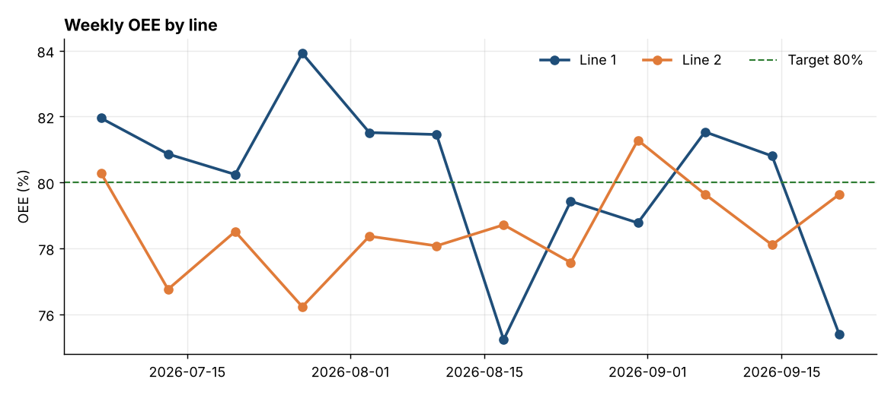
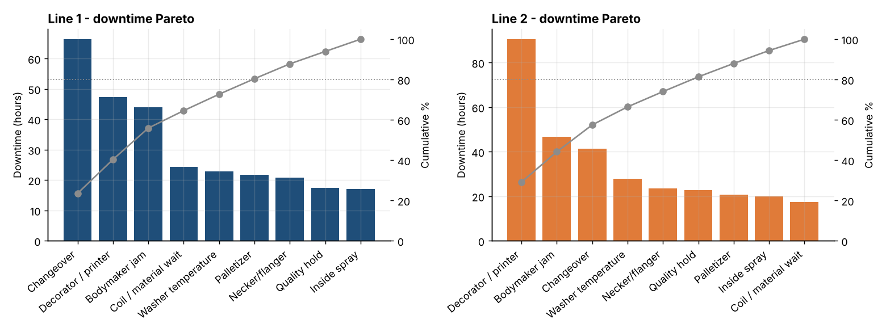
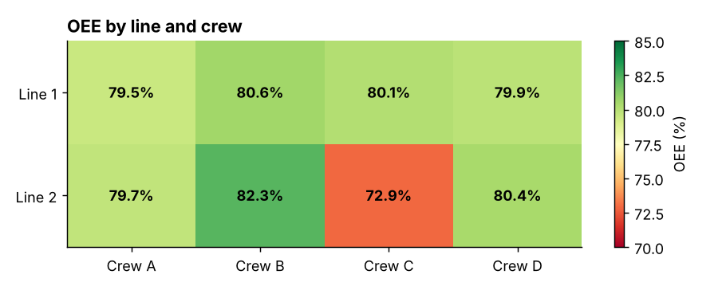
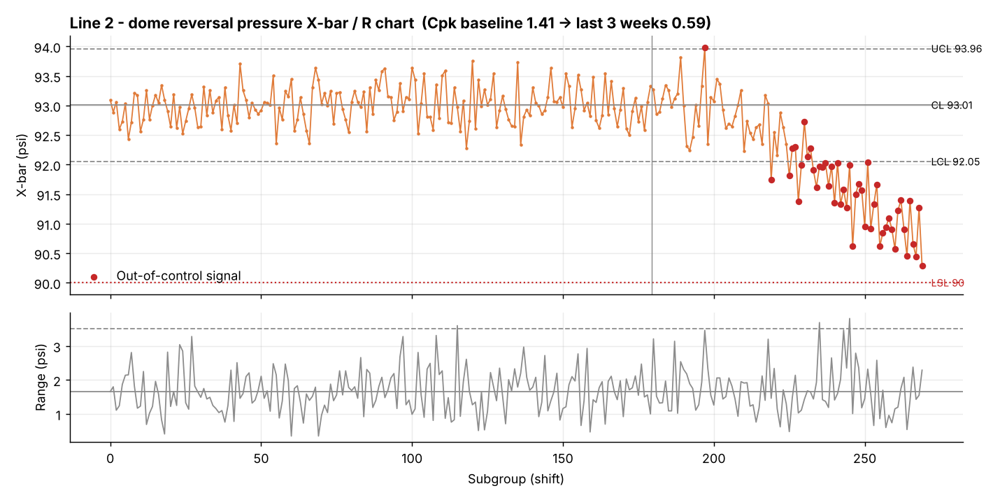

# Can Line Performance Analytics

Alüminyum içecek kutusu üreten bir fabrika için uçtan uca operasyon analitiği: **OEE**, **duruş Pareto analizi**, **ekip karşılaştırması**, **Western Electric kurallarıyla SPC (X-bar/R)**, **proses yeterliliği (Cpk)** ve Excel'de otomatik hazırlanan **günlük operasyon toplantısı raporu**.

> Tüm veriler sentetiktir ve `src/generate_data.py` ile üretilir. Analizin her problemi nasıl tespit ettiğini gösterebilmek için veriye bilinçli olarak problemler yerleştirilmiştir.

## İş sorusu

Fabrikada iki kutu hattı, üç vardiya ve dönüşümlü çalışan dört ekip var. Operasyon ekibi her sabah toplanıyor ve şu sorulara cevap arıyor:

1. OEE hedefini tutturuyor muyuz, zamanı nerede kaybediyoruz?
2. Kayıp makineden mi, yoksa makinenin nasıl çalıştırıldığından mı kaynaklanıyor?
3. Kritik bir kalite karakteristiği spek dışına çıkmadan **önce** kayıyor mu?
4. Bugün aksiyon listesine (PDCA) neler girmeli?

## Sonuçlar

| Bulgu | Kanıt | Önerilen aksiyon |
|---|---|---|
| Hat 2 OEE'si **%78,8**, %80 hedefinin 1,2 puan altında | OEE = Kullanılabilirlik x Performans x Kalite, vardiya verisinden toplanarak hesaplandı | Kullanılabilirlik kayıplarına odaklanılmalı |
| Hat 2'deki dekoratör duruşları **ekibe özgü**: Crew C'de vardiya başına ~52 dk, diğer ekiplerde ~9 dk | Mann-Whitney U testi, p < 0,001; Crew C OEE %72,9, diğer ekipler %79,7-82,3 | Crew C ile gemba, mürekkep/blanket değişim SOP'si ve eğitim kayıtlarının gözden geçirilmesi |
| Hat 1'de dönemin ikinci yarısında changeover sayısı iki katına çıktı, süreleri **~%70 uzadı** (~38 saat ek kayıp) | Önce/sonra karşılaştırması, p = 0,001 | SMED çalışması |
| Hat 2'de dome reversal basıncı aşağı kayıyor; SPC, ilk kutu spek altına düşmeden **5 gün önce** uyarı verdi. Cpk 1,41'den 0,59'a düştü | X-bar/R kartı, kontrol limitleri 60 günlük baz dönemden, Kural 1 + 8 noktalı seri kuralı | Bodymaker dome kalıbında aşınma kontrolü |

Otomatik üretilen detaylı bulgular: [`outputs/insights.md`](outputs/insights.md)

### Haftalık OEE


### Duruş Pareto analizi


### Ekip bazında OEE


### SPC - Hat 2 dome reversal basıncı


## Günlük operasyon toplantısı raporu

`outputs/daily_ops_report.xlsx` her çalıştırmada yeniden oluşturulur ve şunları içerir:

| Sayfa | İçerik |
|---|---|
| Daily KPI | Hat/vardiya/ekip bazında kullanılabilirlik, performans, kalite ve OEE'nin hedefe göre durumu, kırmızı/yeşil renklendirme |
| Top Losses | Bir önceki günün duruşları; neden, süre ve tahmini kayıp kutu adedi |
| SPC Status | Kontrol limitleri, son alt grup, Cpk ve son 3 vardiyada sinyal olup olmadığı |
| Action Log (PDCA) | Sorumlu, termin ve bir sonraki adımla açık aksiyonlar |

## Yöntemler

- **OEE**, toplama hatası (aggregation bias) olmaması için oranların ortalaması alınarak değil, toplam miktarlar üzerinden hesaplandı.
- Duruş nedenlerini önceliklendirmek için **Pareto analizi** (80/20).
- Duruş süreleri çarpık dağıldığı ve çok sayıda sıfır içerdiği için **parametrik olmayan hipotez testi** (Mann-Whitney U).
- **SPC**: X-bar/R kartı (n = 5); Faz I limitleri baz dönemden, Faz II izlemesi Kural 1 (limit dışı nokta) ve art arda 8 nokta kuralıyla.
- **Proses yeterliliği**: alt spek limitine göre tek taraflı Cpk.

## Proje yapısı

```
can-line-performance-analytics/
├── data/                        # sentetik CSV dosyaları (üretilmiş)
├── src/
│   ├── generate_data.py         # üretim, duruş ve kalite verisini üretir
│   └── analysis.py              # OEE, Pareto, testler, SPC, Excel raporu, bulgular
├── outputs/
│   ├── charts/                  # PNG grafikler
│   ├── daily_ops_report.xlsx    # günlük toplantı raporu
│   └── insights.md              # rakamlarıyla bulgular
└── requirements.txt
```

## Nasıl çalıştırılır

```bash
pip install -r requirements.txt
python src/generate_data.py
python src/analysis.py
```

## Araçlar

Python (pandas, NumPy, SciPy, Matplotlib, openpyxl) · Lean / Six Sigma araçları (OEE, Pareto, SPC, Cpk, PDCA, SMED)
